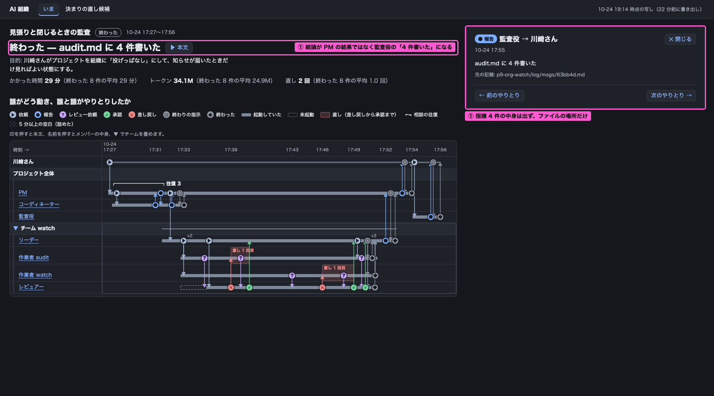
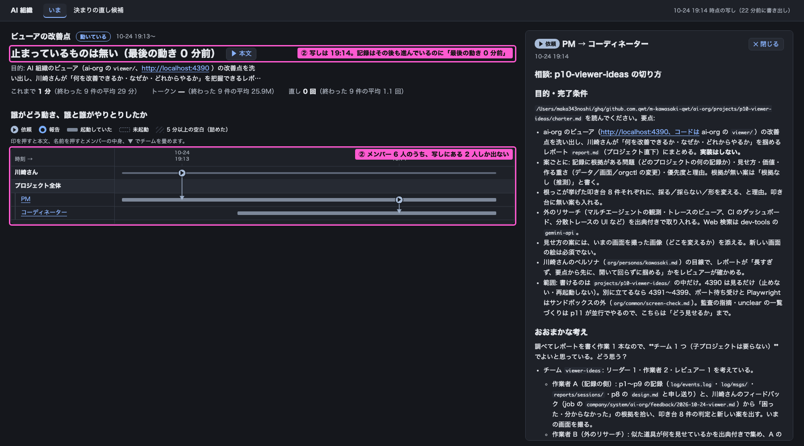
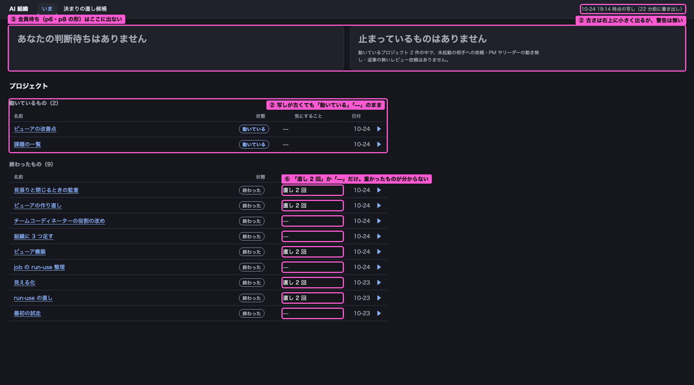
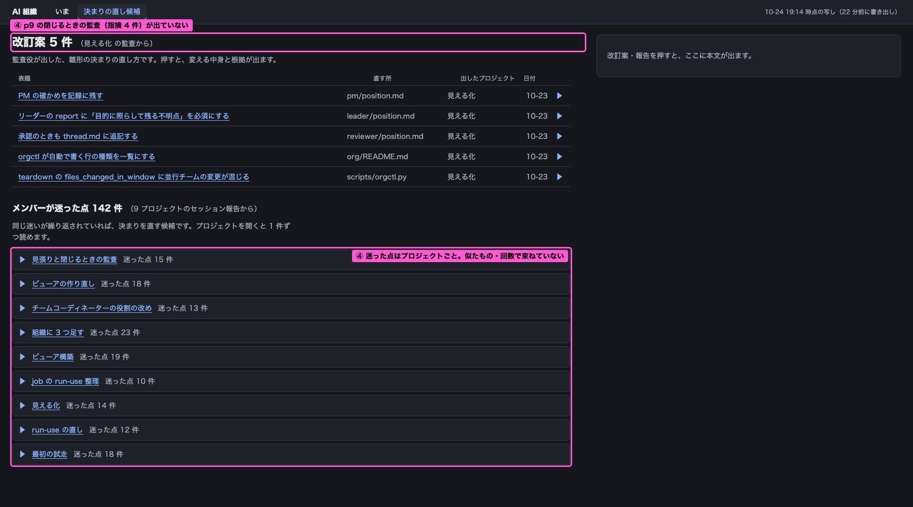
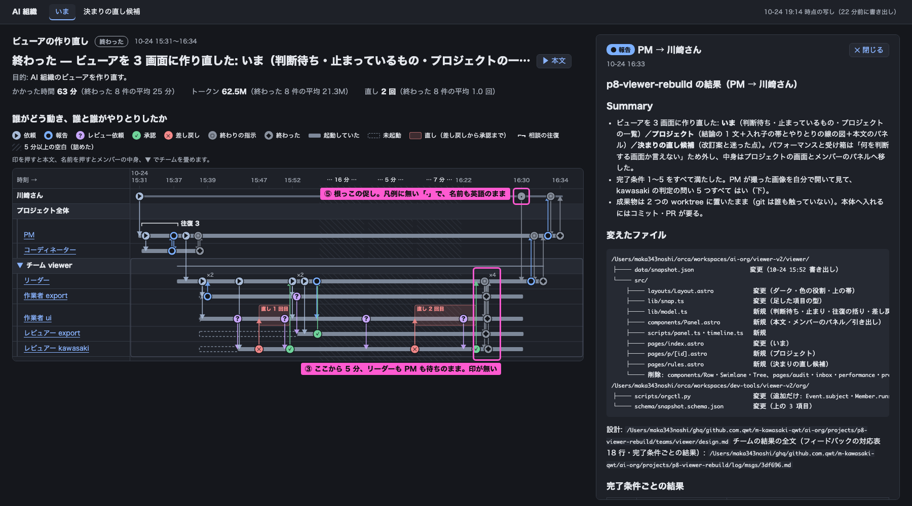

# ビューアの改善点 — 何を・なぜ・どれから

p10-viewer-ideas の成果物。いまのビューア（http://localhost:4390 、p8 で作り直したもの）を、p1〜p9 の記録と撮った画面から見直した。実装はしていない。

## Summary

- **p8 で通った形（3 画面・入れ子の帯・往復の線）は崩さない。** 案はどれも、いまの画面のどこかに足すか、言葉と判定を直すもの。
- **いちばん先にやるべきは「① 結果と監査を分ける」。** p9 から閉じるときに監査役が動くようになり、プロジェクトの結論の 1 文が PM の結果ではなく「audit.md に 4 件書いた」になった。このままだと、これから閉じるプロジェクトは全部そうなる。画面だけで直る。
- 次に、**画面が「いま」を正しく言っていない所を直す**（② 写しの古さ・③ 全員待ち）。動いている p10 の画面は、右上に「22 分前に書き出し」（撮ったとき）と小さく出ているのに、本体は「最後の動き 0 分前」で、メンバー 6 人のうち 2 人しか出ていなかった。p6・p8 の全員待ちは、いまの「止まっているかもしれない」の規則では出ない。
- 叩き台 8 件の判定: 採る 1・形を変える 5・採らない 1・後回し 1（[表](#叩き台-8-件の判定)）。叩き台に無い案を 3 つ足した（①・④ の監査の指摘・⑥）。
- 載せた数は全部スクリプトの出力（[数字の出どころ](#数字の出どころ)）。根拠の全一覧は [evidence.md](teams/viewer-ideas/evidence.md)。

### 推奨する上位 5 件

| 順 | 名前 | なぜ先か | 重さ |
|---|---|---|---|
| 1 | ① 結果と監査を分ける | p9 以降、閉じたプロジェクトは毎回結論が監査役の 1 行になり、結果も監査の中身も読めない | 画面だけ |
| 2 | ② 写しの古さを出す | 本体の文が書き出した時刻を「いま」として数え、古い状態を「0 分前」と出す。①〜⑤ のどれを見るにも前提 | 画面だけ（定期の書き出しは運用） |
| 3 | ③ 全員待ちを出す | 見張りの知らせ（チャット）と画面が食い違う。知らせを受けて開いても画面は「止まっていない」 | orgctl 小・画面 小 |
| 4 | ④ 直し待ちを束ねる | p9 の監査の指摘 4 件が画面のどこにも無い。p11 の一覧の受け皿が要る | 画面 中（p11 の形を読むなら orgctl 小） |
| 5 | ⑤ 人の手に印 | 根っこの促しが凡例に無い「·」で、名前も英語。数える前に、図で見分けられる形にする | 画面だけ |

## 目次

- [叩き台 8 件の判定](#叩き台-8-件の判定)
- [① 結果と監査を分ける](#-結果と監査を分ける)
- [② 写しの古さを出す](#-写しの古さを出す)
- [③ 全員待ちを出す](#-全員待ちを出す)
- [④ 直し待ちを束ねる](#-直し待ちを束ねる)
- [⑤ 人の手に印](#-人の手に印)
- [⑥〜⑨ 優先度の低い案](#-優先度の低い案)
- [外のリサーチから取り入れた考え方](#外のリサーチから取り入れた考え方)
- [数字の出どころ](#数字の出どころ)

---

## 叩き台 8 件の判定

| 叩き台 | 判定 | 理由（1 行） | 本文 |
|---|---|---|---|
| 1 前回から何が変わったか | 後回し | 記録に「変わったものが分からなかった」場面が無い（根拠なし・推測）。判断待ちと止まりはホームが既に答えている | ⑨ |
| 2 写しの時刻と古さの警告 | 採る | 時刻は右上に出ているが、本体は書き出した時刻で数え、22 分古い p10 を「最後の動き 0 分前」と出す。警告も無い。根っこの申告そのものは記録に見つからなかった | ② |
| 3 誰が誰を待っているか | 形を変える | 別の図は作らず、「止まっているかもしれない」に全員待ちを足し、待ちの鎖を 1 行で。p9 の見張りの判定と同じものを出す | ③ |
| 4 成果物（PR・ファイル）へつなぐ | 形を変える | PR の番号が記録に無い（git のコミットにだけある）。先に閉じるときに記録へ残す形が要る | ⑧ |
| 5 完了条件ごとの通否と根拠 | 形を変える | 結果の報告の書き方がそろっておらず（表は 9 件中 1 件）、画面で拾えない。先に PM の報告の型を決める | ⑦ |
| 6 人の手の回数 | 形を変える | 数える前に図で見分ける。記録に残る手は 9 件中 2 回だけで、回数を並べても判断が変わらない | ⑤ |
| 7 直し待ちの画面 | 形を変える | 新しい画面にせず「決まりの直し候補」を作り替える。監査の指摘（p9 の 4 件）と p11 の一覧を頻度順に | ④ |
| 8 プロジェクトをまたいだ推移 | 採らない（いまは） | 9 件では線が判断を変えない（直しは 0 か 2、判断の依頼・止まっているは全部 0、時間とトークンは中身の大きさで決まる）。20 件ほど溜まったら見直す | ⑥ に一部 |

[↑ 目次へ](#目次)

## ① 結果と監査を分ける

叩き台に無い案。

- **問題:** p9 の結論の 1 文が「終わった — audit.md に 4 件書いた」になっている。結論は「川崎さん宛ての最後の報告」から取る決めで（p8 の `design.md:111-112`）、p9 からは監査役の報告（17:55）が PM の結果（17:53）より後に来るため。PM の結果にある「4 の最後の 1 つは閉じるときに確かめる」（一部保留）も、監査の指摘 4 件の中身も、画面に出ない（指摘は snapshot に載っているのに、画面のコードが読んでいない）。根拠: E-01〜E-06（[evidence.md](teams/viewer-ideas/evidence.md#-結果と監査を分ける)）。
- **見せ方:** 結論の 1 文は PM（入れ子なら子のリーダー）の結果から取る。その下に 1 行「監査の指摘 4 件 ▶」を足し、押すと指摘の表題が 1 件 1 行で出て、各行から参照元（1 行報告・本文・セッション報告）へ辿れる。指摘の本文は今のパネルに出す。
- **川崎さんにとっての価値:** 閉じたプロジェクトを開いたとき、「何ができたか（と保留）」と「組織の進め方で何が起きたか」を、パネルを開かずに見分けられる。いまは本文を開いてファイルの場所を辿らないと、どちらも分からない。
- **作る重さ:** データの足し なし（`audit_findings` は snapshot にある）／画面の足し 小（結論の取り方の条件 1 つと、1 行の畳み）／orgctl の変更 なし。
- **優先度: 1。** これから閉じる全プロジェクトで結論が壊れる。直す量に比べて効きが最も大きい。
- **いまの画面のどこを変えるか:** 枠の 2 か所（結論の 1 文・パネル）。

[↑ 目次へ](#目次)

## ② 写しの古さを出す

叩き台 2 を採る。

- **問題:** 写しの古さは右上に「19:14 時点の写し（22 分前に書き出し）」と出ている（開いた時刻から数えている）。ところが本体の文は、書き出した時刻を「いま」として数えている（`viewer/src/lib/snap.ts:5`）。19:36 に撮った p10 の画面は「止まっているものは無い（最後の動き 0 分前）」と出し、メンバーは記録の 6 人のうち 2 人しか出ていなかった（19:28 時点で写しの後に 21 行進んでいた）。右上の補足の色の小さな文字のほかに、警告は無い。書き出しは手で、定期ではない。根っこが申告した「古い写しで混乱した」場面そのものは、記録の中に見つからなかった。根拠: E-07〜E-11。
- **見せ方:** 右上の古さの表示は今のまま。足すのは 2 つ: ① 本体の「最後の動き N 分前」「N 分待ち」「止まっているかもしれない」の分を、開いた時刻から数え直す（右上と同じ基準にそろえる）。② 動いているプロジェクトがあり、写しが 5 分より古いときは、上の帯の下に警告の帯「写しは 22 分前（19:14）。動いているプロジェクトの状態は古い可能性がある」を出す（色と「！」の形）。閉じたプロジェクトしか無いときは出さない（閉じたものは変わらないため）。
- **川崎さんにとっての価値:** 「止まっていない」「判断待ちは無い」を信じてよいかが、開いた瞬間に分かる。古いのに安心して閉じる、が無くなる。
- **作る重さ:** データの足し なし／画面の足し 小（上の帯と分の数え方）／orgctl の変更 なし。古さそのものを無くすには、p9 で決めた常駐の見張り（`patrol --once`）と同じ間隔で `orgctl export` を回す運用が要る（Orca の automation に 1 行足す。登録は人）。
- **優先度: 2。** ①〜⑤ のどれも、写しが新しい前提で読む。画面だけで済む。
- **いまの画面のどこを変えるか:** p10 の結論の 1 文と図（下）、ホームの右上の時刻と「動いているもの」（③ の画像）。

[↑ 目次へ](#目次)

## ③ 全員待ちを出す

叩き台 3 の形を変える。

- **問題:** p8 でリーダーがメンバー 4 人の done を 16:25:58 に受けたあと、根っこが 16:30:56 に促すまで、誰も何も出さなかった。p6 でも研究チームのリーダーが done を受けて 9.1 分止まった。いまの「止まっているかもしれない」の規則（ア〜エ）は、依頼やレビュー依頼を受けた側しか見ないので、この 2 つはどちらも出ない（p8 の `design.md` の当てはめでも、出るのは p1 の 2 件だけ）。p9 で見張り（patrol）が全員待ちを判定して知らせるようになったが、その判定は snapshot に載らず、ビューアは別の規則で判定している。根拠: E-12〜E-16。
- **p9 の見張りのあとも画面に出す意味は残るか:** 残る。知らせはチャットに来るが、川崎さんはそれを見て画面を開く。そのとき画面が「止まっているものはありません」と言えば、知らせと画面が食い違い、どちらを信じるかを考えることになる。判定は 1 か所（orgctl）にし、画面はそれを写すべき。
- **見せ方:** 別の「待ちの図」は作らない。ホームの「止まっているかもしれないもの」に全員待ちを 1 行で足し、待ちの鎖を役割の名前で書く: 「全員待ち 5 分: リーダーが done 4 件を受けたまま／PM はリーダーの報告を待つ」。プロジェクトの図では、その区間を今の斜線の面で塗り、注記「全員待ち 5 分」（今の「動き無し」「返事無し」と同じ形・同じ言葉）。外の道具の、役割を決めて人に割り当て、人を役割で扱う考え方（[incident.io](https://docs.incident.io/incidents/roles)）を鎖の 1 行の書き方に、全体の時間を決めている区間を強調する考え方（[Jaeger](https://www.jaegertracing.io/docs/2.22/deployment/frontend-ui/)）を図の 1 区間に、それぞれ絞って取り入れる。
- **川崎さんにとっての価値:** 知らせを受けて開いたとき、誰に何を促せば動くかが 1 行で分かる。いまは events.log の時刻を自分で読み合わせる必要がある。
- **作る重さ:** データの足し あり（patrol の全員待ちの判定を、export が snapshot に載せる）／画面の足し 小（今の枠に行を足す・図の斜線の規則を 1 つ足す）／orgctl の変更 あり（export に、patrol と同じ関数の結果を書く。小）。
- **優先度: 3。** 知らせと画面の食い違いは、見張りが常駐した時点で毎回起きる。
- **いまの画面のどこを変えるか:** ホームの上の 2 枠（下）と、p8 の図の 16:25〜16:31（⑤ の画像の右下の枠）。

[↑ 目次へ](#目次)

## ④ 直し待ちを束ねる

叩き台 7 の形を変える（監査の指摘を出すのは叩き台に無い分）。

- **問題:** 「決まりの直し候補」は p3 の改訂案 5 件だけを見出しにし、p9 の閉じるときの監査の指摘 4 件がどこにも無い。迷った点 142 件はプロジェクトごとに畳んであるだけで、同じ迷いが重なっていても見えない（例: 「レビュアーの指摘の回数を 2 段で通算するか」が p8 のコーディネーターと PM の両方にある）。川崎さんは「要点をまとめて課題として渡し、深掘りしたら元の記録まで辿れる」形を求めている。根拠: E-17〜E-20。
- **見せ方:** 画面は増やさず、「決まりの直し候補」の頭を「直し待ち N 件」にする。1 件 1 行で「問題（1 行）・出た回数・出たプロジェクト ▶」、回数の多い順。押すとパネルに参照元の一覧（1 行報告・本文・セッション報告の場所）。中身（何を 1 件とし、何をまとめるか）は p11 の一覧と監査役の出力をそのまま使い、画面では作らない。各行に推奨の印（「直す」「様子を見る」「重複」）を文字で付けると、川崎さんは選ぶだけになる（[Linear の Triage](https://linear.app/docs/triage) の「受け箱で 1 操作で選ぶ」考え方。ビューアは読むだけなので押して反映するボタンは作らない）。迷った点のプロジェクトごとの畳みは、その下に今のまま残す（元の記録への道）。
- **川崎さんにとっての価値:** 「どの決まりを直すか」を、142 件を開かずに上から数件で決められる。同じ問題が何回出たかで、急ぐかどうかが分かる。
- **作る重さ:** データの足し あり（監査の指摘は snapshot にある。p11 の一覧を載せるなら export が読む）／画面の足し 中（表 1 つと並べ替え）／orgctl の変更 p11 の形しだい（小）。
- **優先度: 4。** 監査の指摘を出す所までは ① と同じく画面だけで、すぐできる。p11 の一覧の受け皿は、p11 の形が決まってから。
- **いまの画面のどこを変えるか:** 枠の 2 か所（見出し・迷った点の畳み）。

[↑ 目次へ](#目次)

## ⑤ 人の手に印

叩き台 6 の形を変える。

- **問題:** 9 プロジェクトで、手続き（依頼・終わりの指示・閉じるときの片づけ）以外に根っこが手を入れた記録は 2 回だけ（p1 の PM の入れ替え・p8 の促し）。ところが p9 の charter には「根っこが 15 分おきに見て手で促していた」、プランには「ビューアの直しを根っこが直接入れた」とあり、記録に残らない手がある。記録に残った促しも、画面では種類の表に無いため灰色の「·」で、名前は英語の `nudge` のまま、凡例にも無い。根拠: E-21〜E-24。
- **見せ方:** 回数の推移は出さない。まず図で見分ける: 促し・入れ替えなど根っこの手を、川崎さんの帯の上に専用の形（例「✋」）と注意の色で出し、凡例に「根っこの手」と足す。プロジェクトの画面の数字 3 つの横に「根っこの手 1 回」を足す（0 回なら出さない）。人の発言を別の種類として記録しておけば数えるだけで出る、という外の道具の作り（[LangSmith の Trajectory](https://www.langchain.com/blog/langsmith-trajectories-tracing)）に合わせ、記録に残らない手は `orgctl event nudge` で残す決まりにする（記録の側の話。画面の外）。
- **川崎さんにとっての価値:** どのプロジェクトが根っこの手で動いたかを、図を見ただけで見分けられる。組織の決まりのどこが足りないかの手がかりになる。
- **作る重さ:** データの足し なし（`nudge`・入れ替えは記録にある）／画面の足し 小（種類の表に 1 行・凡例・数字 1 つ）／orgctl の変更 なし（記録に残す決まりは雛形の文の話）。
- **優先度: 5。** 小さく直せるが、いまの記録では 2 回しか無いので、急がない。
- **いまの画面のどこを変えるか:** p8 の図の右上の枠（促し）。右下の枠は ③。

[↑ 目次へ](#目次)

## ⑥〜⑨ 優先度の低い案

| 案 | 問題（根拠） | 見せ方 | 価値 | 重さ | 優先度と理由 |
|---|---|---|---|---|---|
| ⑥ 外れ値を一覧に（叩き台に無い） | ホームの「気にすること」が「直し 2 回」か「—」しか無い。直しは 9 件とも 0 か 2 で、重かった p8（時間 2.2 倍・トークン 3.1 倍、中央値比）が一覧で分からない（E-25、ホームの画像の右の枠） | 閉じたものの「気にすること」に、中央値から最も外れた 1 つを出す（「トークン 3.1 倍」）。外れていなければ「—」。普通と違うものから見せる考え方（[Honeycomb の BubbleUp](https://docs.honeycomb.io/investigate/analyze/identify-outliers)） | 開いて結果を確かめるプロジェクトを一覧で選べる | 画面だけ（中央値の計算 1 つ） | 低。開くかどうかが変わるのは数件 |
| ⑦ 完了条件の通否（叩き台 5） | 結果の報告の「完了条件ごと」の書き方がそろっていない（表は 9 件中 p8 だけ）。p9 の「4 の最後の 1 つは閉じるときに確かめる」のような保留が、本文を読まないと分からない（E-05・E-26） | 先に雛形の PM の報告に「完了条件ごと」の表（条件・結果・根拠の場所）を決め、画面は結論の 1 文の下に「完了条件 5 件中 5 件済（1 件は保留）▶」を出す。結果の要点を 1 枚にする考え方（[GitHub Actions の job summary](https://github.blog/news-insights/product-news/supercharging-github-actions-with-job-summaries/)） | 保留が残っているかを、本文を開かずに見つけられる | 雛形の変更あり・画面 小・orgctl なし | 低。① で PM の結果が結論に出れば、保留の多くは 1 文に出る |
| ⑧ 成果物へつなぐ（叩き台 4） | 成果物は worktree に置いたまま、PR は根っこ、と報告に書かれる（p5〜p9 の 5 件）。PR の番号は git のコミットにだけあり、記録に無い（E-27） | 閉じるときに根っこが PR の URL を `component.json` に残し、プロジェクトの画面の見出しの横に「PR ▶」。マージ済みかは GitHub で見る（ビューアは読むだけ） | どのプロジェクトの成果が本体に入ったかを辿れる | orgctl の変更あり（閉じるときに URL を書く）・画面 小 | 低。マージは川崎さん本人がしていて、困った場面が記録に無い |
| ⑨ 前回からの変化（叩き台 1） | 根拠なし（推測）。記録に「何が変わったか分からなかった」場面が無い。判断待ち・止まりはホームが既に答えている | 開いた時刻をブラウザに覚えさせ、一覧の行に「新」「終わった」の印だけ付ける（1 件ずつの既読の操作は作らない）。前に見た時点を基準にする考え方（[GitHub の通知の受信箱](https://docs.github.com/en/subscriptions-and-notifications/how-tos/viewing-and-triaging-notifications/managing-notifications-from-your-inbox)） | 久しぶりに開いたとき、どこから見るかが分かる | 画面だけ | 低（後回し）。プロジェクトが 1 日数件の間は一覧で足りる |

[↑ 目次へ](#目次)

## 外のリサーチから取り入れた考え方

全体は [research.md](teams/viewer-ideas/research.md)（11 件）。案の判断を変えたものだけ載せる。

| 考え方 | 出典 | どの案のどこに効いたか |
|---|---|---|
| 判断を受け箱で「選ぶ 1 操作」にする | https://linear.app/docs/triage | ④ 直し待ちの各行に推奨の印を文字で付ける（ボタンは作らない） |
| 役割を決めて人に割り当てる（人を役割で扱う） | https://docs.incident.io/incidents/roles | ③ 待ちの鎖を、メンバーの名前ではなく役割で「リーダーが…／PM は…」の 1 行で書く。別の図にしない |
| 全体の時間を決めている区間を強調する | https://www.jaegertracing.io/docs/2.22/deployment/frontend-ui/ | ③ 全員待ちの区間だけを図で塗る（強調はこの 1 種類に絞る） |
| 「平均」ではなく「普通と違うもの」から見せる | https://docs.honeycomb.io/investigate/analyze/identify-outliers | ⑥ 気にすることの列に、外れた 1 つだけを出す |
| 人の発言を別の種類として記録すれば、回数は数えるだけで出る | https://www.langchain.com/blog/langsmith-trajectories-tracing | ⑤ 回数を出す前に、根っこの手を種類として記録・表示する |
| 要点の層と詳細の層を分ける（ただし層は増やさない） | https://www.langchain.com/blog/langsmith-trajectories-tracing | 全体: いまの「図 → パネル」の 2 段を保ち、① ④ は 1 行を足して畳む形にした |
| 結果の要点を実行ごとに 1 枚にする | https://github.blog/news-insights/product-news/supercharging-github-actions-with-job-summaries/ | ⑦ 完了条件の通否を 1 行に。手で書かせず、型を決めて機械的に出す |

取り入れなかったもの: プロジェクトをまたいだ変化率のダッシュボード（research.md の件 8）。9 件では点が少なく、叩き台 8 と同じ理由で採らない。

[↑ 目次へ](#目次)

## 数字の出どころ

| 数 | 出したスクリプト（`teams/viewer-ideas/scripts/`） | 比べる相手・モデル |
|---|---|---|
| p6 の 9.1 分・p8 の 16:25:58〜16:30:56 | `gaps.py`（配送記録を除いた行で、プロジェクト全体の間）と events.log の該当行 | 5 分（p9 の見張りの全員待ちの〔仮〕の値 `ALLWAIT_MIN`） |
| p8 の時間 2.2 倍・トークン 3.1 倍、直しは 0 か 2、判断の依頼・止まっているは 0 | `count_records.py`（component.json の開閉の時刻、セッション報告の `tokens_total` の合計、1 行報告の種類の数） | 閉じた 9 件の中央値（時間 28.7 分・トークン 20.1M） |
| 根っこの手 2 回（記録の行で 4 行） | `count_records.py`（`user` の行から、根っこの PM・監査役への依頼・終わりの指示・最初の起動・閉じるときの片づけを除いた残り） | 手続きの行 |
| 迷った点 142 件 | `count_records.py`（セッション報告の unclear の箇条） | 画面の表示（142 件）と一致 |
| 写しの後に 21 行・メンバー 6 人／2 人 | `checks.py`（19:28 に実行。snapshot の `generated_at` より後の行） | snapshot の中身 |
| 結果の報告の完了条件の表 9 件中 1 件・PR の言及 | `checks.py`（PM → 川崎さんの最初の report の本文を正規表現で見る） | — |

出力は `scripts/output.txt`。画像は `scripts/annot.mjs`（Playwright。4390 を見るだけ）で撮り、ページの上に枠を重ねた。幅は 1800px・ダーク。

[↑ 目次へ](#目次)
